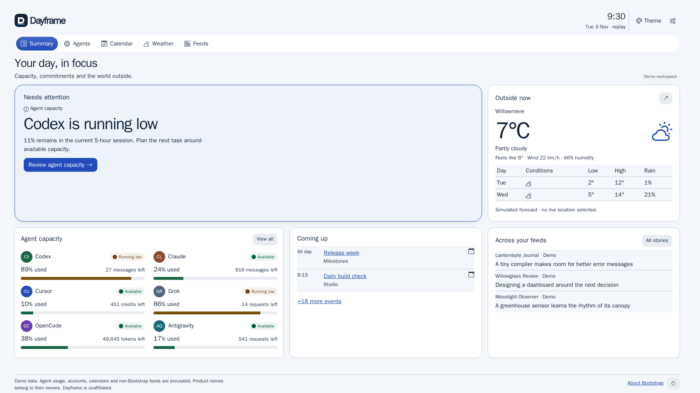
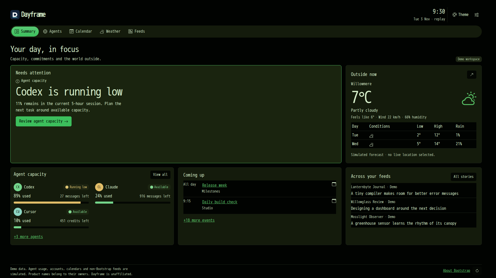

# Dayframe

Dayframe is a glanceable dashboard for AI agent usage, calendar, weather and
feeds. It is also a long-running Bootstrap 6 demonstrator, and runs as a static
site using simulated data.

The five views put agent capacity, the next event, weather and headlines in one
place. Agent usage, calendars and non-Bootstrap stories are always simulated.
Weather uses Open-Meteo; Bootstrap headlines come from its blog and public
release feed. No accounts, credentials, analytics or backend are involved.



The initial build is prelaunch. Indexing is disabled. The live URL will appear
in the GitHub Pages deployment summary after repository setup and validation.
Public launch remains a separate approval. See the [roadmap](docs/roadmap.md)
and [CI setup](docs/ci.md) for pending release operations.

## Run locally

Use Node 26 and npm:

```sh
npm ci
npm run dev
```

Open the development server at `/dayframe-dashboard/`. `npm run build` produces
the static site in `dist/`; `npm run preview` serves that production build.

## Explore the demo

- **Summary:** the most urgent event or constrained agent, capacity, agenda,
  weather and headlines. Short desktop windows collapse extra rows into
  explicit links; narrow windows scroll.
- **Agents:** six invented quota histories and reset windows. Real product
  names appear as plain text, without logos.
- **Calendar:** a month view with repeating, overlapping, all-day and multi-day
  invented events. Select a date or open an event's details.
- **Weather:** current conditions, seven days and an hourly table. Search for a
  city in Settings; location permission is requested only after clicking
  “Use my location.”
- **Feeds:** live Bootstrap headlines and clearly labelled simulated stories,
  with category filters and paging.

Settings includes appearance, display, weather, calendar, feeds and demo
controls. Number keys 1–5, `s`, `a`, `c`, `w`, `f` and arrow keys navigate;
`,` opens Settings. Editable controls keep their native keys. Rotation pauses
during interaction and while the page is hidden.

URL settings override saved preferences only for that visit. For a repeatable
replay, use `?clock=2026-11-03T09:30:00Z&seed=reference`. A frozen clock and
non-steady scenarios use simulated sources, with no live requests. Try
`?scenario=running-low`, `reconnect`, `reminder-due`, `stale` or `offline`.

## Themes

- **Default:** porcelain, navy and cobalt, in light and dark.
- **Nebuchadnezzar:** a dark-only black, green and olive console, with an
  optional static CRT finish.
- **Tideline:** a teal and coral instrument panel, in light and dark.



Run `npm run new-theme <id>` to create a theme. The registry and tests discover
its folder automatically. The [theme contract](docs/themes.md) describes the
tokens, supported schemes, options and accessibility requirements.

About Bootstrap reports the pinned release and custom CSS footprint. Enable
the Bootstrap lens there, in Settings → Demo, or with `?lens=1` to inspect
components. The [Bootstrap log](docs/bootstrap-log.md) records custom gaps and
upstream findings.

## Validate

```sh
npm run check
npm test
npm run build
npm run test:browser
```

Browser validation uses Playwright 1.64.1 and its pinned Noble container. The
functional suite runs in Chromium, Firefox and WebKit. Chromium screenshots
cover all views and supported theme/scheme combinations at eight viewports,
each at device pixel ratios 1 and 2. Clock, seed, locale and time zone are
fixed. Remote APIs are mocked in tests. Screenshot projects fix font subpixel
positioning and Skia's CPU path. The approved colour threshold is `0.005`,
with `maxDiffPixels: 0`; this permits tiny colour noise, not exact pixel
equality. Initial baselines and intentional visual updates require review;
missing snapshots fail comparisons. See [CI setup](docs/ci.md) for the reviewed
400-image replacement set and pending final validation.

Full-history gitleaks checks run in CI and in the trusted deployment gate. No
`DAYFRAME_DENYLIST`, personal access token or provider account is needed.
Keep private credentials, private contact details and addresses, home-directory
paths, private hostnames, private account/project IDs and private repository
references out of tracked content, commits and PR text. Public author credits,
attribution and legal notices are allowed; simulated data still uses invented people,
organisations and places. [CI setup](docs/ci.md) records the independent secret
scan required before the trusted listener's first installation on `main`.

## Licence

Dayframe is released under the [MIT License](LICENSE). The frontend-design
skill in `.agents/skills/frontend-design/` is © Anthropic, under the Apache
License 2.0.
